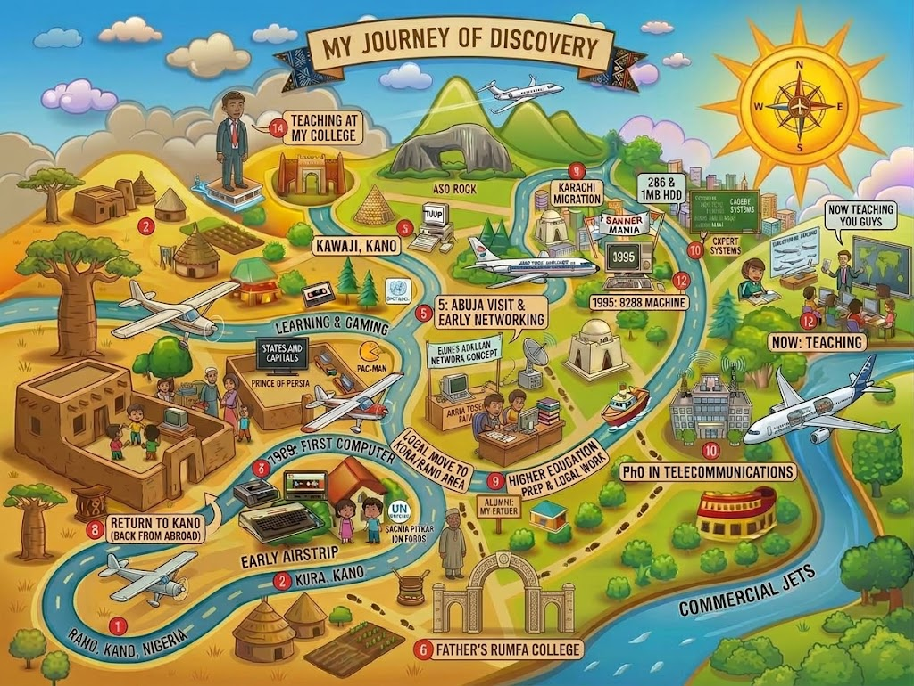

# AI for Educators: Future-Ready Teaching

*My journey of discovery: Dr. Faisal Iradat*

A 4-hour hands-on faculty workshop on using AI in teaching: building a Socratic course AI tutor in Microsoft Copilot Studio, creating teaching materials with AI, understanding plagiarism and AI detection (Turnitin), and embedding tools in Sakai.

- **Date:** Tuesday, 20 October 2026
- **Venue:** Board Room, Tabba Building, Main Campus, IBA Karachi
- **Organised by:** IBA-CICT and SMCS
- **Trainer:** Dr. Faisal Iradat
- **Tools:** Microsoft Copilot Studio (main); Claude.ai and ChatGPT (alternatives); Sakai LMS; Turnitin

**The one rule:** AI should guide students, not do the work for them.

## Agenda

| Time | Block | Mins |
| --- | --- | --- |
| 0:00–0:20 | Opening and mindset shift | 20 |
| 0:20–0:55 | Live demonstrations | 35 |
| 0:55–1:10 | Break | 15 |
| 1:10–2:15 | Activity 1: Build your course AI Tutor | 65 |
| 2:15–2:30 | Quick sharing | 15 |
| 2:30–2:45 | Break | 15 |
| 2:45–3:35 | Activity 2: Create teaching materials with AI (choose 2–3) | 50 |
| 3:35–3:55 | Plagiarism and AI detection | 20 |
| 3:55–4:15 | Embedding in Sakai, action plan and close | 20 |

## Using the materials

1. Start with the participant handout and the instruction templates; they work as written once the [brackets] are filled.
2. Copilot Studio menu names change between releases. If a label differs, look for the nearest match.
3. Turnitin facts were checked on 19 October 2026 against Turnitin's own guides; re-check before reuse.
4. Never upload student names, IDs, grades or unreleased exams to any AI tool.
